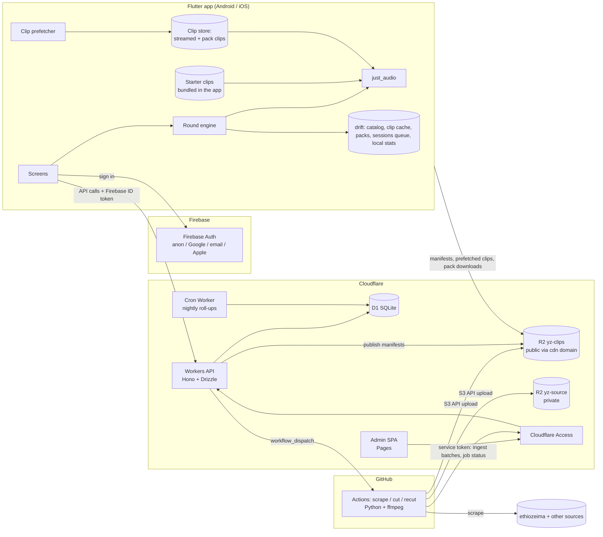
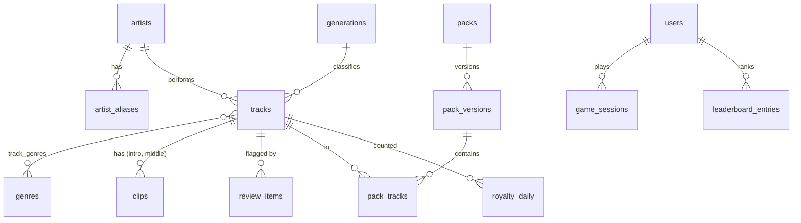

# Yeman Zefen (የማን ዘፈን) — Architecture & Roadmap

**Status:** v1 architecture · **Date:** 2026-10-12 (play-first delivery: 2026-10-14) · **Builder:** solo, with Claude Code
**Source:** `prd-amharic-music-game.md` (Final v1)

---

## 1. Overview

Yeman Zefen is a free, ad-supported music-guessing game for Amharic music. A player hears a short clip, taken from the intro or from the middle of the song, and picks the song or artist from four options. It runs on Android and iOS from one Flutter codebase and works in Amharic or English. The first round plays straight away from clips bundled in the app, upcoming clips download in the background while the player plays, and players who want to play without a connection can download song packs from Settings.

Two audiences shape the design. Domestic players are mostly on Android with limited data, so the game starts without sign-up or a download, spends little data per round, and can play fully offline from packs. Diaspora players skew iPhone and are worth more in ad revenue, so the app needs global leaderboards and a quality iOS build.

Behind the app sits a catalog operation. A Python scraper and clip cutter feed a curated, admin-reviewed catalog. Packs are built from that catalog, and every play is logged for royalty reporting to the music association.

**Core goals for v1**
- Make the core loop feel instant: tap, clip plays, answer, feedback.
- Play first: nothing (no sign-up, no download prompt) stands between opening the app and the first round.
- Small, on-demand downloads while playing, and optional offline packs in Settings that make play cost zero data.
- A catalog that is accurate before players see it, through a review queue.
- Leaderboards that are hard to cheat, using server-authoritative scoring.
- Run at $0 hosting at launch scale.

## 2. Chosen stack & rationale

| Layer | Choice |
|---|---|
| Mobile | Flutter (Dart). `just_audio`, `drift`, `background_downloader`, Riverpod, `go_router`, FlutterFire, `google_mobile_ads`. Bundled Noto Sans Ethiopic. |
| Identity | Firebase Authentication: anonymous (guest), Google, email/password, and **Sign in with Apple** (iOS, see §6) |
| API | Cloudflare Workers, TypeScript, **Hono** (routing), **zod** (validation), **jose** (JWT verification), **Drizzle ORM** over D1 |
| Database | Cloudflare D1 (SQLite) |
| Audio and manifests | Cloudflare R2: `yz-clips` (public, behind CDN domain) and `yz-source` (private, full source audio) |
| Admin dashboard | Vite + React + TypeScript, **Mantine** UI, TanStack Query, React Router, `wavesurfer.js`. Hosted on Cloudflare Pages. |
| Admin auth | **Cloudflare Access** (Zero Trust, free up to 50 users) in front of the admin site and the `/admin/*` API |
| Ingestion jobs | Existing Python scraper + ffmpeg clip cutter, run on **GitHub Actions** (triggered by the Worker via `workflow_dispatch`, or on schedule) |
| Scheduled work | Workers Cron Triggers (nightly roll-ups) |
| Ads | AdMob + Google UMP consent SDK |
| Crash reporting | Firebase Crashlytics |

**Why this fits this project specifically**
- **$0 at launch.** Every layer has a free tier that covers 1,000 DAU with room to spare. R2's free downloads matter most for an audio app.
- **One vendor for data, API, and audio.** Workers, D1, and R2 talk through bindings with no network hops or credentials. Firebase is limited to answering one question: is this really this user?
- **Guest mode with no extra work.** Firebase anonymous auth gives each guest a real user ID. Linking a Google, email, or Apple account later **keeps the same ID**, so guest history carries over without a migration (except in one conflict case, see §6).
- **Ingestion reuses existing code.** GitHub Actions runs your Python and ffmpeg unchanged, and it is free for this workload. The Worker only starts jobs and receives results.
- **Vite + React, not Next.js, for the admin site.** It's an internal tool behind a login. A static site on Pages is simpler to deploy and Next.js's server features add nothing here.
- **Solo-builder friendly.** There are no servers to patch. Each piece (`api/`, `admin/`, `app/`, `ingest/`) can be built and tested on its own, which suits one Claude Code session per task.

## 3. System architecture



**Request flows**

1. **Catalog in.** Admin clicks "Run scraper". The Worker creates an `ingest_jobs` row and dispatches the `ingest-scrape` workflow. The scraper normalizes and transliterates records, runs the duplicate check, and uploads source audio to `yz-source`. It then POSTs track batches to `/admin/ingest/*` using a Cloudflare Access service token. The Worker upserts tracks, auto-assigns eras, and writes `review_items` for anything uncertain.
2. **Clips.** Approving a track, or changing its clip start time, dispatches `ingest-cut`. That workflow cuts a 10 s intro clip and a 10 s middle clip, uploads them to `yz-clips`, and registers them with checksums.
3. **Packs out.** Admin builds a pack version. The Worker writes an immutable manifest to `yz-clips/packs/{slug}/v{n}/manifest.json` and bumps `packs.current_version`.
4. **Play.** Rounds are generated **on the device** from whatever clips are on it. This is one code path for online and offline play. Clips get onto the device in three ways, all stored and checked the same way (SHA-256 against the manifest):
   - **Starter clips**, bundled in the app build (see "Play-first delivery" below), so the first round needs no network.
   - **Prefetched clips.** When online, the app lists packs via `/v1/packs` and downloads their manifests (small JSON with every track's metadata and clip URLs). While a session runs, it downloads the clips for the next few rounds in the background. These live in a size-capped cache.
   - **Offline packs**, downloaded on request from **Settings → Offline play**. Their clips are pinned and never evicted, so play needs no data at all.
5. **Score.** At session end the app POSTs the round **events** (not a score) to `/v1/sessions`. If offline, it queues them and sends later. The Worker validates the events, computes the score, stores one `game_sessions` row, and updates leaderboard rows if the user is registered.
6. **Report.** A nightly cron rolls `game_sessions` up into `royalty_daily`, `ad_events_daily`, and `analytics_daily`. The admin site reads only these roll-ups.

> **Design decision (differs from the PRD's endpoint list):** the PRD's `/rounds/next`, `/plays`, and `/scores` are merged into **`POST /v1/sessions`**. Generating rounds on the device is required for offline play anyway. Sending one payload per session keeps D1 writes per session at about 6 rows instead of about 60, which is the main defense against the 100k-writes-per-day free-tier limit. Per-track royalty counts are still exact, because each session row stores the track IDs it played.

> **Design decision: play-first delivery (differs from the PRD's pack-first wording).** The PRD has players download a pack before playing. Asking for a download before the first round is the worst moment for friction, so the app instead:
> 1. **Bundles a starter set** of about 25 tracks' intro and middle clips (about 8 MB) in the app. They come from a normal pack, `starter`, built in the admin site; a build script copies its manifest and clips into the app's assets. A first launch with no network still plays a full session.
> 2. **Prefetches as you play.** Online, the app keeps the next 5 rounds' clips downloaded ahead of the round being played. Only the correct track's clip is needed; the three wrong options are names from the manifests. A round whose clip is not ready when it comes up is swapped for a track whose clip is already on the device, from the session's era and not already used in the session. Only when no such track exists (an era the device has no clips for) does the round wait for its download, showing a "next song loading" state, and it is skipped without penalty if the download fails or takes over 10 s. At about 160 KB per round, a 10-round session costs about 1.6 MB.
> 3. **Caches with a cap.** Prefetched clips stay in a cache of 50 MB by default, evicting the least recently played first. Starter and offline-pack clips never count against it or get evicted.
> 4. **Moves packs to Settings.** "Offline play" in Settings lists packs to download for play with no connection, with "Wi-Fi only" for pack downloads (on by default), "Download upcoming songs on mobile data" (on by default; off is a data saver that plays only from clips already on the device when on cellular), storage used, and "Clear cache".
>
> FR-16 and FR-17 still hold: packs are versioned manifests with checksums, cached for offline play, with a notice (a badge on Settings → Offline play) when an installed pack has an update. No API change is needed: the published pack manifests are the catalog the prefetcher reads. A session's `offline` flag means the device had no connection during the session, not that it played from a pack.

**Clip precision.** Clips are **pre-cut files** whose audio starts exactly at the chosen moment. The app always plays from 0 and stops at 3, 5, or 10 s with `ClippingAudioSource`. No seeking happens inside long files, which removes the PRD's precision concern. Format: MP3, CBR 128 kbps, mono or stereo as sourced, about 160 KB per 10 s.

## 4. Data model



**Tables** (SQLite types; all timestamps are integer epoch ms, UTC)

- `artists` (id, **name_am UNIQUE** = canonical key, name_latin, created_at, updated_at)
- `artist_aliases` (id, artist_id, alias, alias_norm UNIQUE, source)
- `generations` (id, slug, name_am, name_en, year_from, year_to, sort). Seeded with golden-age (to 1979), 80s, 90s, 2000s, modern (2010+). Admin-editable.
- `genres` (id, slug, name_am, name_en) and `track_genres` (track_id, genre_id). Seeded with tizita, ethio-jazz, traditional, pop, hip-hop.
- `tracks` (id, artist_id, title_am, title_latin, album, release_year, generation_id, generation_overridden, source_url, source_audio_key, duration_ms, **status** `ingested | needs_review | approved | rejected | retired`, canonical_track_id NULL, created_at, updated_at)
- `clips` (id, track_id, **type** `intro | middle`, start_ms, length_ms default 10000, r2_key, sha256, bytes, version, status `pending | ready | failed`)
- `review_items` (id, entity_type, entity_id, **reason** `translit_uncertain | possible_duplicate | missing_audio | short_audio | era_unknown | score_anomaly`, entity_ref (text key for user items; `entity_id` is 0), details_json, status `open | resolved | dismissed`, resolved_by, resolved_at)
- `packs` (id, slug, name_am, name_en, generation_id NULL, genre_id NULL, current_version)
- `pack_versions` (id, pack_id, version, manifest_key, track_count, total_bytes, published_at, published_by)
- `pack_tracks` (pack_version_id, track_id, intro_clip_id, middle_clip_id)
- `users` (**id = Firebase UID**, display_name, is_anonymous, country, created_at, last_seen_at, shadow_banned, deleted_at)
- `game_sessions` (**id = client UUID, the idempotency key**, user_id, mode, generation_id, difficulty, client_started_at, received_at, rounds, score, track_ids_json, events_json, offline, country, flagged, flag_reason). This replaces the PRD's `scores` table.
- `leaderboard_entries` (period `all | 2026-W42`, generation_id with 0 = all, user_id, points, updated_at). PK (period, generation_id, user_id). Index (period, generation_id, points DESC).
- `moderation_log` (id, at, admin_email, action `shadow_ban | shadow_unban | void_session | dismiss_session | dismiss_flag | resolve_flag`, user_id, session_id, review_item_id, note, details_json). Append-only, no foreign keys. A unique index on (session_id, action) for void and dismiss makes a repeat a no-op.
- `royalty_daily` (date, track_id, plays). PK (date, track_id).
- `ad_events_daily` (date, country, format, event, count)
- `analytics_daily` (date, metric, dimension, value). Covers DAU, new users, sessions, rounds, plays by country, and `retention_d1`/`retention_d7`/`retention_d30`: a COUNT of the cohort day's new users who played 1, 7 or 30 days later, keyed by the cohort date and written by the later day's run (so a day's own re-run keeps them). The share is the count over that day's `new_users`; no row means not known yet.
- `admin_users` (email, role `admin | editor`, created_at)
- `ingest_jobs` (id, kind `scrape | cut | recut`, status `queued | running | succeeded | failed`, params_json, gh_run_url, started_at, finished_at, summary_json)

**Amharic normalization (`alias_norm`, and the dedupe key for `name_am`):** NFC, trim, collapse whitespace, and fold homophone Fidel series to one form (ሀ/ሐ/ኀ→ሀ, ሰ/ሠ→ሰ, አ/ዐ→አ, ጸ/ፀ→ጸ, each across all seven orders). Latin forms are lowercased with diacritics and apostrophes stripped. The canonical `name_am` keeps the spelling the admin chose. Only the comparison key is folded.

**Scoring formula** (the single source of truth, also in `docs/scoring.md`; client shows a provisional score, server decides):
- Base points by clip length: 10 s = 100, 5 s = 150, 3 s = 200. "Middle" mode multiplies by 1.25.
- Answer window = clip length + 5 s. Speed bonus = round(0.5 × base × max(0, 1 − response_ms / window_ms)).
- Correct = base + bonus. Wrong = 0. A rewarded-ad hint (removes 2 options) halves the round's points.
- Generation-guess mode (FR-12): correct = 120 + speed bonus on the 10 s window, no difficulty tiers.
- **Sanity bounds:** response_ms < 200 marks that round invalid (0 points) and flags the session. More than 50 rounds per session is rejected. The sum of response times must fit inside the session's duration. Options must be 4 distinct, existing IDs that include the correct one.

## 5. API design

All JSON. Errors use the shape `{ error: { code, message } }`. Versioned under `/v1`.

**Player API** (requires a Firebase ID token in `Authorization: Bearer`; anonymous allowed unless noted)

| Endpoint | Purpose |
|---|---|
| `GET /v1/config` | Tunables: interstitial frequency (3), register-prompt threshold (5 sessions), min app version |
| `GET /v1/packs` | Published packs with current version, size, track count, manifest URL |
| `PUT /v1/me` | Upsert user (display name, country from `cf.country`), updates last_seen |
| `DELETE /v1/me` | Account deletion (required by both stores); anonymizes sessions, removes leaderboard rows |
| `POST /v1/me/registered` | After linking kept the uid (registered only): marks the user registered and rebuilds their leaderboard rows from their sessions |
| `POST /v1/me/merge` | Conflict-case merge (registered only): body carries the old anonymous ID token (accepted up to 30 days old); moves its sessions into the caller's account and rebuilds the caller's leaderboard rows. 409 if that uid is not a guest |
| `POST /v1/sessions` | Submit a session's round events plus ad event counts. Idempotent on `id`. Returns the computed score. |
| `GET /v1/leaderboard?period=all\|week&generation=` | Top 100. Registered, non-shadow-banned users only. |
| `GET /v1/leaderboard/me?period=&generation=` | Caller's points and rank (registered only) |
| `POST /v1/reports/clip` | `{ trackId, clipType, error }` (`file_missing \| decode_error \| too_short`): a clip would not play on the phone. Adds to one open `missing_audio` review item per track. 10 per user per day (`429 rate_limited`). |

**Session payload (shape):**
```json
{ "id": "uuid", "mode": "intro|middle|generation", "generationId": 0, "difficulty": "easy|medium|hard",
  "clientStartedAt": 0, "clientEndedAt": 0, "offline": true,
  "rounds": [{ "trackId": 0, "question": "song|artist|era", "optionIds": [0,0,0,0],
               "chosenId": 0, "responseMs": 0, "hintUsed": false }],
  "ads": { "interstitialShown": 0, "rewardedCompleted": 0 } }
```

**Admin API** (`/admin/*`, behind Cloudflare Access; the Worker verifies the Access JWT and checks `admin_users`)

- Catalog: `GET/POST/PATCH /admin/tracks`, `POST /admin/tracks/:id/approve|reject`, `GET/PATCH /admin/artists`, `POST /admin/artists/:id/merge`, alias CRUD
- Review: `GET /admin/review-items`, `POST /admin/review-items/:id/resolve|dismiss`
- Clips: `PATCH /admin/clips/:id` (start_ms triggers a recut job)
- Jobs: `POST /admin/jobs` (scrape | cut | recut), `GET /admin/jobs`
- Packs: `POST /admin/packs`, `POST /admin/packs/:id/versions` (build and publish)
- Reports: `GET /admin/reports/royalty?from&to&format=json|csv` (admin role; UTC days, both included, at most 366; the CSV is UTF-8 with a byte order mark and a final total row; `missingDays` lists the days in the range with no finished roll-up, and a CSV with any is named `-partial`), `GET /admin/analytics?from&to`
- Moderation (admin role only; every action takes a required `note` and is written to `moderation_log` with the admin's email): `GET /admin/moderation/queue` (open `score_anomaly` flags and flagged sessions not yet voided or dismissed, up to 100 each), `GET /admin/moderation/users/:id` (profile, this week's and all-time points, 25 recent sessions with per-round details, flags, the log), `POST /admin/users/:id/shadow-ban { banned, note, reviewItemId? }` (hides the player from other players' boards at once, the public top 100 within its 60 s cache; keeps their points, so unbanning restores them; `reviewItemId`, ban only, must be the player's open anomaly flag and is resolved and logged as `resolve_flag`), `POST /admin/sessions/:id/void { note }` (marks the session `voided`; if it still counted, subtracts its score from the player's all-time and week rows for all eras and its era, floor 0, and reports `pointsRemoved` as the most any one row actually lost; a repeat is a no-op), `POST /admin/sessions/:id/dismiss { note }` (a flagged session is reviewed and left as is), `POST /admin/moderation/flags/:id/dismiss { note }`. The track review routes no longer close items about players (`entity_type = 'user'`).
- Ingest (Access **service token**, used by GitHub Actions): `POST /admin/ingest/tracks`, `POST /admin/ingest/clips`, `POST /admin/ingest/jobs/:id/status`, `GET /admin/ingest/catalog-snapshot` (for dedupe)

## 6. Auth & security

- **Players:** every `/v1` request verifies the Firebase ID token with `jose`. That means checking the signature against Google's securetoken JWKS (cached), `iss = https://securetoken.google.com/<project>`, `aud = <project>`, and `exp`. The middleware exposes `uid` and `isAnonymous` (from `firebase.sign_in_provider`). Users read and write only their own rows. Leaderboard writes and rank reads require `isAnonymous === false`.
- **Guest → account:** the app calls `linkWithCredential` on the anonymous user, which keeps the UID. The server then backfills leaderboard rows from that user's existing sessions. **Conflict case:** if the Google, email, or Apple account already belongs to another UID, the app captures the anonymous ID token, signs in to the existing account, and calls `/v1/me/merge`. The server verifies both tokens and moves the sessions over.
- **Sign-out and deletion:** both leave the app as a new anonymous guest. Sign-out first sends the sessions still queued, which carry no uid, so they count for the account. It then drops the device's local bests. Deletion first checks how long ago the player signed in, using a freshly issued ID token's `iat` minus `auth_time` (both Firebase's clock). If that is 4 minutes or more, the player signs in again with a linked provider (Firebase's `requires-recent-login`). An Apple account always signs in with Apple again, because its fresh authorization code is used to revoke the app's Apple tokens (App Store guideline 5.1.1(v)). Cancelling that sign-in changes nothing. Next, the queued sessions are dropped and any upload already running is waited for, so nothing reaches the server afterwards. Then `DELETE /v1/me` runs, the local bests are dropped, the Apple tokens are revoked, and the Firebase user is deleted. If Firebase still refuses after the server step, the player stays signed in and is told to delete again, which finishes the job (`DELETE /v1/me` can safely run twice).
- **Sign in with Apple is required on iOS.** App Store guideline 4.8 requires an equivalent privacy-focused login option when an app offers third-party login like Google. This is missing from the PRD and is included in Phase 3. It's free with the Apple Developer account.
- **Admins:** Cloudflare Access (one-time PIN to email, or Google) protects `admin.<domain>` and `api.<domain>/admin/*`. The Worker still verifies the `Cf-Access-Jwt-Assertion` header against the team's JWKS and checks the email against `admin_users`. This is defense in depth, so a misconfigured Access rule doesn't expose the API. GitHub Actions uses an Access **service token** stored as a repo secret.
- **Anti-cheat (R-5):** server-authoritative scoring and sanity bounds (§4) in v1. A nightly anomaly pass flags velocity and accuracy outliers. Shadow-banned users still see their own scores.
- **Secrets:** Worker secrets via `wrangler secret`. GitHub Actions secrets: R2 S3 keys and Access service token. GitHub fine-grained PAT (Actions: write, on this repo only) stored as a Worker secret for `workflow_dispatch`.
- **Privacy & compliance:** in-app account deletion (both stores require it). UMP consent for EEA, UK, and other regulated diaspora users before personalized ads. iOS App Tracking Transparency prompt. Privacy policy covering AdMob, Firebase Auth, Crashlytics, and the country derived from IP. Play Data safety form and Apple privacy labels.
- **Rate limiting:** per-UID and per-IP limits on `/v1/sessions` and the leaderboard (Phase 5).

## 7. Third-party integrations

| Service | Used for | Notes |
|---|---|---|
| Firebase Auth | Identity (anon, Google, email, Apple) | Free tier; phone/SMS deferred (needs Blaze plan) |
| Firebase Crashlytics | App crash reports | Free; same Firebase project |
| Google AdMob + UMP | Interstitial and rewarded ads; consent | Mediation can be added later without code changes in the game |
| GitHub Actions | Ingestion jobs; Android CI build; Claude Opus PR review | Private repo: 2,000 free minutes per month |
| Claude Code GitHub Action | Opus code review on every task PR | Billed to an Anthropic API key or a Claude Code OAuth token; Opus usage is the main variable cost of the build |
| GitHub REST API | `workflow_dispatch` from the Worker | Fine-grained PAT |
| Cloudflare Access | Admin SSO | Free up to 50 seats |
| ethiozeima (scraped) | Catalog metadata and audio | Usable only with written master-recording license (R-1); see §10 on site terms |

## 8. Infra & deployment

**Repo layout (monorepo)**
```
yeman-zefen/
├── CLAUDE.md              # short conventions file Claude Code loads every session
├── docs/                  # architecture.md, scoring.md, design/ (tokens, screen specs, copy, artifact HTML, screenshots)
├── api/                   # Cloudflare Worker (Hono, Drizzle) + migrations/ + cron
├── admin/                 # Vite + React admin SPA
├── app/                   # Flutter app
├── ingest/                # Python: scraper, clip_maker, normalize, dedupe, client
└── .github/workflows/     # ci.yml, ingest-scrape.yml, ingest-cut.yml, app-android.yml
```

**Environments:** `dev` (local `wrangler dev` with local D1 and R2, Firebase emulator optional) and `prod`. Add a `staging` Worker and D1 only when the beta starts. Flutter flavors are `dev` and `prod`, pointing at the matching API base URL and Firebase project.

**Domains:** `api.<domain>` (Worker), `admin.<domain>` (Pages behind Access), `cdn.<domain>` (R2 `yz-clips` public custom domain).

**CI/CD:**
- `ci.yml` runs on PR: typecheck, lint, and test `api/` and `admin/`; `flutter analyze` and `flutter test`; `pytest` for `ingest/`.
- `claude-review.yml` runs on every PR push: Claude Opus (`claude-opus-5-5`) reviews the diff against `CLAUDE.md` and the task checklist. Its verdict is a required status check on `main`, alongside `ci.yml`.
- Deploy: `wrangler deploy` and `wrangler d1 migrations apply` on merge to `main` (manual approval for prod). Pages deploys automatically from `admin/`.
- Mobile: an Android release build (AAB) via GitHub Actions. **iOS builds run locally on your Mac** with Xcode and are uploaded to TestFlight. macOS runners use free minutes 10× faster, so CI for iOS is optional later.

## 9. Non-functional requirements

**Performance:** p95 under 300 ms for `/v1/packs`, `/v1/leaderboard`, and `/v1/sessions`. A round has no network path at all, since it always plays from a local file. The network only runs ahead of play, prefetching later rounds' clips.

**Data and storage on the device:** about 160 KB per round when prefetching (about 1.6 MB per 10-round session), zero with the data saver on cellular or with offline packs. Starter clips add about 8 MB to the app download. The clip cache is capped at 50 MB by default.

**Scale and the D1 write budget:** D1 bills rows written *including index entries*. Measured per session (`docs/perf.md`): **14 rows** for a returning registered player and 20 for a new one (the session and its indexes, up to 4 leaderboard upserts and their indexes, the user touch, and the rate-limit bucket). The rate-limit bucket is 2 of those 14. The nightly cron writes about 1,000 to 2,000 table rows (royalty rows are at most one per track played that day), more once index entries count, plus one row per session it trims at 90 days. At 1,000 DAU with 2 sessions each, that's about 28k writes per day, against a 100k free limit. The limit becomes tight around **3,000 DAU**.

**D1 database size** comes first, though: a session row is about 2 KB, and the Free plan caps a database at 500 MB. Trimming `events_json` after 90 days (to about 1 KB a row) slows the growth but does not bound it: at 1,000 DAU the cap is about 5 months away (`docs/perf.md`). Plan to move to Workers Paid at $5/month (10 GB per database) once the beta is past about 1,000 DAU, which removes both limits at this scale.

**Storage:** clips are small (about 330 KB per track for intro and middle), so 1,000 tracks is about 330 MB. **Source audio is the storage pressure point:** at about 5 MB per full song, 1,000 songs is about 5 GB in `yz-source`. That fits the 10 GB free tier. Beyond it, R2 costs about $0.015 per GB-month, roughly cents per month.

**Observability:** Workers Logs (structured JSON with request ID, UID hash, route, latency), Crashlytics for the app, and `ingest_jobs` summaries for pipeline runs. Admin analytics come from the nightly roll-ups.

**Cost shape at launch:** hosting $0. Fixed costs are Apple at $99/year and Google Play at $25 once. Variable costs are royalties and, later, Workers Paid at $5/month and SMS auth if it's ever added.

**Timeline shape:** 13 sprints at 1–2 weeks each, including 2 design sprints, comes to roughly **4–6 months solo**.

## 10. Risks & open questions

| # | Risk / question | Impact | Proposed handling |
|---|---|---|---|
| R-1 | Written license covering **master recordings** | Blocks public launch, not building | Build Phases 1–4 in parallel; gate open beta on the signed license |
| A-1 | **Clip URLs are public** on the CDN, so anyone can bulk-download clips | May conflict with license terms | Ask the association whether public 10 s clips are acceptable. If not, switch to short-lived signed URLs from the Worker. Prefetching fetches clips one at a time, so sign per manifest (one Worker request returns signed URLs for a whole manifest) rather than per clip. |
| A-8 | **Starter clips ship inside the app binary** (play-first delivery, §3) | The license may not cover distributing clips in a store build | Ask the association alongside A-1. If not allowed, ship no starter clips and download the `starter` pack silently on first launch instead; the first round then needs a connection. |
| A-9 | Prefetching **uses mobile data** without asking | Cost for domestic players on limited data | Small per-round cost (about 160 KB), a data-saver toggle in Settings, and offline packs over Wi-Fi as the zero-data option |
| A-2 | **Offline sessions are less verifiable** (no server-issued round list) | Weekly board is easier to game offline | v1: sanity bounds + nightly anomaly flags. If abuse appears, give online sessions a server-signed seed and weight or flag offline-only top scores. |
| A-3 | Sign in with Apple required on iOS (guideline 4.8) | App Store rejection if missing | Included in Phase 3 Sprint 2 |
| A-4 | ethiozeima's terms of use for automated scraping | Legal exposure separate from the music license | Confirm the site's terms or get permission; keep scraper polite (rate-limited, identifies itself) |
| R-2 | Transliteration and dedupe quality | Wrong answers shown to players | Homophone-folding normalization + review queue; nothing goes live unapproved |
| R-4 | Catalog cold start | Repetitive rounds | ~200 approved tracks before closed beta; Phase 1 exit criterion |
| A-5 | D1 write ceiling at ~12–15k DAU | Writes start failing | Watch writes per day in the dashboard; switch to Workers Paid ($5/mo) at 70% |
| A-6 | Design drift between mockups and the built app | Rework, inconsistent screens | designs are approved in artifacts with a handoff package, Phase 2 rebuilds them as real Flutter screens on mock data, and Phase 4 wires those same widgets to real data, and design changes after sign-off go through a PR that re-exports screenshots |
| A-7 | Installs and AdMob revenue aren't in our data | FR-23 analytics are incomplete | Show "new users" (first-seen UIDs) as the install proxy and our own ad event counts; link out to Play Console, App Store Connect, and AdMob for official figures |

---

## Roadmap

**How to run this with Claude Code.** Each task below has a ready-made prompt in `phase-N-sprint-M-prompts.md`. For each task, start a fresh session (or `/clear`), switch to the task's model with `/model haiku`, `/model sonnet`, or `/model opus`, paste the prompt, and work through the checklist before moving on. The aliases resolve to the latest model in each tier (currently `claude-haiku-5-5`, `claude-sonnet-5-5`, `claude-opus-5-5`). For scripted or headless runs, use `claude --model sonnet -p "<prompt>"`.

**Every task ships as its own pull request, reviewed by Claude Opus.** Work on a branch named `task/p<phase>s<sprint>-<slug>`, push it, and open a PR whose description is the task title plus its "Before moving on" checklist (the PR template does this). The `claude-review.yml` workflow (Phase 1 Sprint 1, task 2) runs Claude Opus, pinned to `claude-opus-5-5`, on every push to the PR. It posts a review and sets a required **Opus review** check that blocks merging until the verdict is APPROVE. Fix the findings on the same branch (the review re-runs), then merge, so each task starts from a clean, reviewed `main`. The only exception is the scaffold task, which lands before the review workflow exists.

Model tiers: **Haiku** handles scaffolding and UI over already-built logic. **Sonnet** is the default for feature work. **Opus** handles auth, scoring and anti-cheat, account merging, and dedupe, where a wrong call is costly to undo.

**Non-engineering tracks running alongside:** M0 (license in writing), catalog curation (ongoing from Phase 1 Sprint 3), and, during Phase 2, the native-speaker Amharic copy review and short tests of the prototype with real players.

### Phase 1 — Catalog to first playable round (M2 + clip-playback spike)
*Exit: ~200 approved tracks across all eras in published packs; a bare Flutter build plays a full offline round on a real Android phone and a real iPhone. (Phase 1 installs packs from a list in the spike app. Play-first delivery, §3, replaces that flow in Phase 4 Sprint 1 and reuses its download and checksum code.)*

**Sprint 1 — Foundations**
1. Scaffold monorepo, Worker hello-world, and CLAUDE.md (haiku)
2. Per-task PR workflow with required Claude Opus code review (sonnet)
3. D1 schema, migrations, and seed data (sonnet)
4. Admin auth middleware: Cloudflare Access JWT + role check (opus)
5. Catalog admin API: artists, aliases, tracks, clips (sonnet)
6. Ingest API for GitHub Actions: batch upserts, job status, catalog snapshot (sonnet)

**Sprint 2 — Ingestion pipeline**
1. Era auto-assignment and missing-year flags on ingest (haiku)
2. Wire the scraper to the ingest API and the source bucket (sonnet)
3. Fidel ↔ Latin transliteration module with confidence flags (sonnet)
4. Artist and track duplicate detection (opus)
5. Clip cutter: intro and middle clips to R2 + registration (sonnet)
6. GitHub Actions workflows + Worker dispatch + job tracking (sonnet)

**Sprint 3 — Admin dashboard v1 & packs**
1. Admin SPA shell (haiku)
2. Tracks table, editor, and approve/reject workflow (sonnet)
3. Review queue UI (sonnet)
4. Clip start-time editor with waveform and recut (sonnet)
5. Pack builder: versioned manifests published to R2 + `/v1/packs` (sonnet)
6. Jobs page: run and schedule scraper, job status (haiku)

**Sprint 4 — Flutter playable spike**
1. Flutter scaffold: flavors, structure, fonts, local DB (haiku)
2. Pack download with checksum verification (sonnet)
3. Clip playback service with `just_audio`, verified on both platforms (sonnet)
4. Round engine: question generation, distractors, provisional scoring (sonnet)
5. Bare round screen + session recorder (sonnet)

### Phase 2 — UI/UX design (M1)
*Sprint 1 is done in a claude.ai chat with artifacts, not in Claude Code. Sprint 2 turns the approved designs into real Flutter screens on mock data, so Phase 4 wires them up instead of rebuilding them. Exit: you complete the sign-off checklist in `docs/design/review.md`, with both languages reviewed and the prototype tried by real players.*

**Sprint 1 — Design in Claude artifacts** (step guide, no Claude Code prompts)
1. Brief, screen list, and bilingual copy
2. Wireframes in both languages
3. Visual direction (pick one of three)
4. Hi-fi screens, including an interactive round screen
5. Handoff package to `docs/design/`: tokens.json, screens.md, copy.md, artifact HTML, screenshots

**Sprint 2 — UI: theme, hi-fi screens & clickable prototype**
1. Flutter theme and component library from tokens (sonnet)
2. Hi-fi screens, part 1: home, mode, era/genre, settings with offline play (sonnet)
3. Hi-fi screens, part 2: round, feedback, results, leaderboard, sign-in (sonnet)
4. Edge states: first launch, consent, offline, out of songs, update, errors (haiku)
5. Clickable prototype and screenshot export for sign-off (sonnet)

### Phase 3 — Accounts, scoring & leaderboards (M3)
*Exit: guests play and sync; registration links accounts on all three providers without losing history; leaderboards show server-computed scores; admin can export a royalty report.*

**Sprint 1 — Identity & sessions**
1. Firebase setup + anonymous sign-in + authenticated API client (sonnet)
2. Firebase JWT middleware in the Worker (opus)
3. `/v1/me` upsert and account deletion (sonnet)
4. `POST /v1/sessions`: server-authoritative scoring, sanity bounds, idempotency (opus)
5. Offline session queue and sync (sonnet)
6. Nightly cron roll-ups: royalty, ads, analytics (sonnet)

**Sprint 2 — Registration & leaderboards**
1. Remote config endpoint + app config loader (haiku)
2. Leaderboard endpoints (sonnet)
3. Account linking: Google, email, Apple + conflict merge + backfill (opus)
4. Soft registration prompt logic (haiku)
5. Wire the prototype's sign-in and leaderboard screens to real services (haiku)

**Sprint 3 — Admin v2: reporting & moderation**
1. Royalty usage report page + CSV export (haiku)
2. Analytics dashboard (sonnet)
3. Anomaly detection pass in the nightly cron (sonnet)
4. Moderation UI: flagged sessions, shadow-ban (sonnet)

### Phase 4 — Production app from the approved prototype (M4)
*Requires the Phase 2 sign-off. The theme, components, ARB strings, and prototype screens already exist; this phase moves each screen into its feature folder and wires it to real data and services. Exit: feature-complete app in both languages on both platforms.*

**Sprint 1 — Production shell & localization**
1. Production localization and live language toggle (sonnet)
2. Play-first clip delivery: starter clips, prefetch, clip cache (sonnet)
3. Wire home, mode select, era/genre select, and settings screens (haiku)
4. Wire Settings → Offline play: pack download and data settings (sonnet)

**Sprint 2 — Game experience**
1. Round screen wired to the real engine and audio (sonnet)
2. Modes, difficulties, and the generation-guess bonus mode (sonnet)
3. Wire the results screen (haiku)
4. Edge-case handling: bad audio, corrupt clips, no network (sonnet)

**Sprint 3 — Account settings & ads**
1. Account settings, sign-out, and account deletion (sonnet)
2. AdMob: consent, ATT, interstitials, rewarded hint (sonnet)

### Phase 5 — Hardening & beta (M5–M7)
*Exit: signed builds on Play closed testing and TestFlight; store compliance paperwork done.*

**Sprint 1 — Hardening & release**
1. Crashlytics and structured Worker logging (haiku)
2. Rate limiting on the player API (sonnet)
3. Performance check against the p95 targets (sonnet)
4. Release pipeline: Android signing and CI build, iOS archive steps (sonnet)
5. Store compliance documents (haiku)

**Beta-fix sprints (M5–M7)** are deliberately not pre-written. Their tasks come from beta feedback. When it arrives, write them with the same template, using Phase 5 as the format reference.
